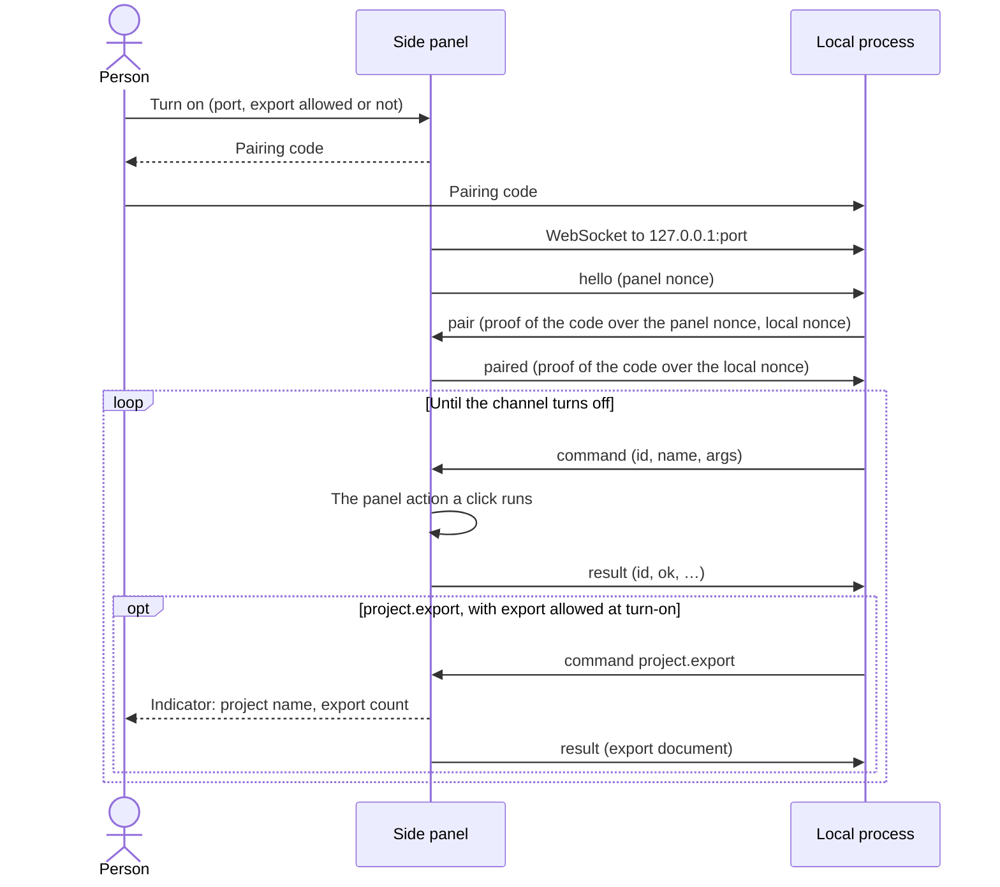

# Docent Local Control Channel

The local control channel lets a process on the same computer run a closed set
of the Chrome extension's side panel actions — create a project, create a
recording, pause and resume capture, commit a step and, when a person allows
it, export the open project — without a person clicking in the side panel. It
is an opt-in channel: a person turns it on in the side panel, hands the pairing
code the panel shows to the local process, and the panel then carries out the
commands that process sends. This document is the formal
specification of that channel: the address, the pairing, the frames, the
command set, and every route by which the channel turns itself off. What a
command does to a project or a recording is defined by the
[Recording Lifecycle](../requirements/functional/recording-lifecycle.md); the
channel adds a second way to trigger those actions and no new action.

Each rule carries a stable identifier (**LC-n**) so other documents, reviews,
and checks can cite it precisely. Identifiers are never renumbered; a retired
identifier stays reserved and is never reused. How each rule is verified — by
an existing named check, by a check that could be built, or by judgment — is
recorded per rule in the [clause registry](../clause-registry.json). The key
words MUST, MUST NOT, SHOULD, and MAY are to be interpreted as described in
[RFC 2119](https://www.rfc-editor.org/rfc/rfc2119). Keywords appear on a
clause's operative requirement where it has one; definitional clauses bind as
stated without a keyword, and subsidiary absolutes inside a clause inherit its
force. A clause's scope runs from its marker to the next marker or heading;
identifiers reflect minting order and can appear out of numeric sequence.

---

## Overview

The extension is the client and the local process is the server: the side
panel opens one WebSocket outward to a port on the loopback address, and the
local process listens there. Nothing listens inside the browser, and a web page
has no part in the exchange.



| Property                  | Value                                                                                                |
| ------------------------- | ---------------------------------------------------------------------------------------------------- |
| Default                   | Off                                                                                                  |
| Turned on by              | A person, in the side panel                                                                          |
| Transport                 | One WebSocket, opened by the side panel page                                                         |
| Address                   | `ws://127.0.0.1:<port>`                                                                              |
| Pairing                   | One-time code shown in the panel, proven both ways by HMAC-SHA256 over each side's nonce             |
| Commands                  | A closed set of seven ([the command set](#the-command-set))                                          |
| Export                    | Only when a person allows it at turn-on, of the project open in the panel, each one in the indicator |
| Lifetime                  | Until turned off, a failed pairing, a lost connection, an unanswered port, or the panel closes       |
| Stored state              | None                                                                                                 |
| New extension permissions | None                                                                                                 |
| Frames the panel sends    | `hello`, `paired`, and one `result` per command; nothing unasked                                     |
| Lengths                   | Every length this document states for text counts UTF-16 code units, as a JavaScript string does     |

---

## Turning the channel on

**LC-1.** The channel is off whenever a side panel opens, and it turns on by
exactly one route: a person's use of the panel's own turn-on control, its Turn
on button or the Enter key in its port field. The control carries one
checkbox, unticked when the panel opens and again each time the channel turns
off, by which the person allows export ([LC-7](#the-command-set)); the grant is fixed when the channel
turns on, stays as given while it is on, and ends when it turns off. Its whole
state — whether it is on, the port, the pairing code, the connection, the
export grant, the count of exports and the name of the project last exported —
lives in the memory of the side panel
page and nowhere else: the extension writes no
storage key for it and sends the service worker no message about it. The
channel therefore ends when the panel closes, and a panel opened afterwards
starts with the channel off. Each open side panel page holds its own channel,
independent of any other's.

**LC-2.** While the channel is on, the panel shows an indicator on every view,
with a control that turns the channel off. Until a local process has paired,
the indicator carries the pairing code. While export is allowed, the indicator
says so, and from the first export on it also carries the name of the project
last exported and the number of exports since the channel turned on; the panel
updates it before it sends the export's result.

---

## Address

**LC-3.** The panel dials exactly one address form: `ws://127.0.0.1:<port>`.
The host is the IPv4 loopback literal, never a name and never another address;
`<port>` is the one value a person supplies, and the panel accepts it only as a
plain decimal whole number from 1024 to 65535. The side panel page's content
security policy names `ws://127.0.0.1:*` as its only WebSocket source, so the
browser itself refuses a WebSocket from the panel to any other host.

The local process MUST listen on the address the panel dials — `127.0.0.1`
on that port — itself and alone: not on a wildcard address, not on another
loopback address, and not on a port another process can also bind. The
pairing proves that each end holds the code; the frames that follow are bound
to the pairing by this connection alone, so a local process that holds the
address and port itself is the one end the panel's frames reach. It accepts
the connection. The browser states the connection's origin in the WebSocket handshake as
`chrome-extension://<extension id>`, a value no web page's connection carries; a
local process that wants to accept the extension alone compares it.

The local process need not be listening when the channel is turned on. While
nothing answers on the port, the panel dials again every 2 seconds with the
same pairing code; a dial that has not connected within 10 seconds counts as
unanswered; and after 150 unanswered dials the panel turns the channel off
([LC-10](#turning-the-channel-off)).

---

## Pairing

A local process holds the pairing code because a person gave it the code. The
pairing is a proof in each direction: the local process proves to the panel
that it holds the code, and the panel proves to the local process that it
holds the same code, without either sending the code itself.

**LC-4.** Each time the channel is turned on, the panel makes a new pairing
code: 16 characters drawn with a cryptographically strong random source from
the 32-character alphabet `0123456789ABCDEFGHJKMNPQRSTVWXYZ`, 80 bits in all, so
that a proof seen on the wire does not let anyone find the code by trying
codes. The panel shows it in four groups of four separated by hyphens; the
hyphens are display only and are not part of the code. Each side has a nonce
of its own for each connection — 32 lowercase hexadecimal characters — and
proves the code over the other side's nonce. A proof is HMAC-SHA256 keyed by
the code's 16 characters (UTF-8) over the message formed by the direction's
label followed by the other side's nonce (UTF-8), written as 64 lowercase
hexadecimal characters. The two labels are the ASCII texts `local:` and
`panel:`, so the local process's proof and the panel's are distinct for any
pair of nonces.

The three frames of the pairing, in order — each carries exactly the fields
its row lists:

| Frame    | Sender        | Fields                            | `nonce`                                                                                                         | `proof`                                     |
| -------- | ------------- | --------------------------------- | --------------------------------------------------------------------------------------------------------------- | ------------------------------------------- |
| `hello`  | Panel         | `type`, `docent_control`, `nonce` | The panel's, drawn from the same random source as the code                                                      | None                                        |
| `pair`   | Local process | `type`, `proof`, `nonce`          | The local process's, which it MUST draw from a cryptographically strong random source, anew for each connection | Over `local:` and the panel's nonce         |
| `paired` | Panel         | `type`, `proof`                   | None                                                                                                            | Over `panel:` and the local process's nonce |

```json
{ "type": "hello", "docent_control": 1, "nonce": "<nonce>" }
{ "type": "pair", "proof": "<proof>", "nonce": "<nonce>" }
{ "type": "paired", "proof": "<proof>" }
```

`hello` is the first frame on the connection. `docent_control` is the version
of this protocol, and this document specifies version 1. A local process that
reads another value is talking to a panel this document does not describe, and
closes the connection. The pairing code itself never crosses the connection.
On a correct `pair` proof the panel answers `paired` and stops showing the
code. A local process that compares the panel's proof with the one it computes
itself knows that its peer holds the code; one that reads another proof closes
the connection and treats nothing it received on it as the panel's.

A worked example, for checking an implementation:

| Value                           | Example                                                            |
| ------------------------------- | ------------------------------------------------------------------ |
| Code as the panel shows it      | `7K3M-Q9XZ-4HTR-WB2N`                                              |
| Key (the code, hyphens removed) | `7K3MQ9XZ4HTRWB2N`                                                 |
| Panel nonce (in `hello`)        | `000102030405060708090a0b0c0d0e0f`                                 |
| Local process proof message     | `local:000102030405060708090a0b0c0d0e0f`                           |
| Local process proof (in `pair`) | `f7fa184f820aad37881d3c7050b7808799e6211b3b75f96e9ad28fe0dbf7538a` |
| Local process nonce (in `pair`) | `0f0e0d0c0b0a09080706050403020100`                                 |
| Panel proof message             | `panel:0f0e0d0c0b0a09080706050403020100`                           |
| Panel proof (in `paired`)       | `0269c0d2e863e07f8a9d5b49f5dc1e4202251c885577e12e8687cdc82a58fcfb` |

**LC-5.** A pairing code is good for exactly one attempt. The first frame the
local process sends after the greeting is that attempt, whatever it holds. The
panel runs no command before a correct proof, and each of these outcomes turns
the channel off and discards the code — the list is closed:

| Outcome before pairing                                   | What the panel does              |
| -------------------------------------------------------- | -------------------------------- |
| A `pair` frame with a wrong proof                        | Closes the connection, turns off |
| A `pair` frame without a nonce of the stated form        | Closes the connection, turns off |
| A `pair` frame with any further field                    | Closes the connection, turns off |
| Any other first frame, a command included                | Closes the connection, turns off |
| A first frame that is not a [well-formed frame](#frames) | Closes the connection, turns off |
| No frame within 10 seconds of the greeting               | Closes the connection, turns off |
| The connection ends                                      | Turns off                        |

Frames the local process sends behind its `pair` frame wait for the proof's
verdict: after a correct proof the panel handles them in order as commands, and
after any other outcome it discards them unanswered. The panel sends its own
proof only after a correct proof.

---

## Frames

**LC-6.** A frame is a WebSocket text message whose content is one JSON
object. A frame the panel receives is at most 16384 UTF-16 code units. After
pairing, a received frame that is not one — a binary message, an oversized one,
malformed JSON, a JSON value other than an object — is answered with a result
whose `id` is `null` and whose `ok` is `false`, and the connection stays open.
The frames the panel sends have no such bound: each result is one frame
whatever its length, an export result included.

---

## The command set

A command frame names one command of the set, with an identifier the local
process chooses and the command's arguments:

```json
{ "type": "command", "id": "<id>", "command": "<name>", "args": { … } }
```

**LC-7.** The command set is closed: exactly the seven commands of the table
below. `id` is text of 1 to 64 characters; `args` is an object, or absent for a
command that takes none. A command frame carries exactly the four fields shown
and its `args` exactly the arguments its row states; a frame with any other
field, argument, or command name is answered with `ok: false` and runs nothing,
and so is a frame after pairing whose `type` is not `command`. The answer
carries the frame's `id` when that `id` is itself valid, and `null` otherwise.
Names and narration are trimmed of surrounding whitespace before the length
bounds apply.

| Command            | Arguments                                                                                                                                                                  | What the panel does                                                        | Result fields on success                                                          |
| ------------------ | -------------------------------------------------------------------------------------------------------------------------------------------------------------------------- | -------------------------------------------------------------------------- | --------------------------------------------------------------------------------- |
| `status`           | None                                                                                                                                                                       | Nothing — a read of the panel's state                                      | `project`, `recording`, `capturing`, `pending_actions`, `steps`, `export_allowed` |
| `project.create`   | `name`: 1 to 200 characters                                                                                                                                                | Creates the project and opens it, stopping capture for an open recording   | `project`                                                                         |
| `recording.create` | `name`: 1 to 200 characters                                                                                                                                                | Creates the recording in the open project and starts capture               | `recording`                                                                       |
| `recording.pause`  | None                                                                                                                                                                       | Pauses capture for the open recording                                      | `capturing`                                                                       |
| `recording.resume` | None                                                                                                                                                                       | Resumes capture for the open recording                                     | `capturing`                                                                       |
| `step.commit`      | Either `narration`: 1 to 10000 characters, or `step_type`: `action` or `validation`, with `expect`: `present` or `absent` on a `validation` alone (`present` when omitted) | Commits the captured actions as a step, as the panel's Done this step does | `step`, `steps`                                                                   |
| `project.export`   | None                                                                                                                                                                       | Builds the export of the open project, as the panel's Export button does   | `project`, `export`                                                               |

`project.export` is carried out only when the person allowed export at
turn-on ([LC-1](#turning-the-channel-on)). Every other action the side panel
offers is outside the set: deleting, renaming, reordering and re-recording,
importing, sending, syncing, and every setting.

**LC-8.** The panel carries out each command through the same panel action a
person's click runs, so its view follows every command — the project opens, the
recording view appears, the step joins the list, whatever view the person had
open — and the service worker receives the messages that click sends. For
`project.export` that is the build the Export button runs: the panel asks the
service worker for the project open in this panel, by its id, and stamps it;
the click then downloads the document, and the command delivers it in its
result instead, opening no dialog. A command
the panel's state cannot carry out is refused: it is answered with `ok: false`,
sends the service worker nothing and changes nothing. The refusals are these —
the list is closed:

| Command                                              | Refused when                                                   |
| ---------------------------------------------------- | -------------------------------------------------------------- |
| `recording.create`                                   | No project is open                                             |
| `recording.pause`, `recording.resume`, `step.commit` | No recording is open                                           |
| `step.commit`                                        | No actions are captured since the last step                    |
| `project.export`                                     | The person did not allow export at turn-on                     |
| `project.export`                                     | No project is open                                             |
| Every command but `status`                           | A person is re-recording a step in the panel                   |
| Every command but `status`                           | A step commit a person started in the panel is still under way |

A pause of a paused recording and a resume of a capturing one succeed and
change nothing. A step committed through the channel with `narration` states no
narration source: the narration was not typed into the panel.

Two effects a command shares with the click it stands for: creating a
recording discards the actions captured and not yet committed, and creating a
project leaves them in the pending buffer, which the next recording opened or
created discards.

---

## Results

**LC-9.** Every command frame the panel handles is answered with exactly one
result frame carrying the command's `id`:

```json
{ "type": "result", "id": "<id>", "ok": true, … }
{ "type": "result", "id": "<id>", "ok": false, "error": "<text>" }
```

The panel runs commands one at a time, in the order their frames arrive, and
sends each result before it starts the next command; a local process is free
to send its next command without waiting. A result carries identifiers, names,
counts and flags, a fixed `error` text when `ok` is `false`, and, on an export
the person allowed, the export document, and nothing else — the fields below
are the complete set — so the captured actions and the project model cross
the channel only inside an export a person allowed, and the extension's
settings never do:

| Field             | Value                                                                                                              |
| ----------------- | ------------------------------------------------------------------------------------------------------------------ |
| `project`         | `{ project_id, name }` of the open project, or `null`                                                              |
| `recording`       | `{ recording_id, name }` of the open recording, or `null`                                                          |
| `capturing`       | Whether capture is running; `false` with no open recording                                                         |
| `pending_actions` | The number of actions captured since the last step                                                                 |
| `steps`           | The number of steps in the open recording; `0` with none open                                                      |
| `step`            | `{ logical_id, step_number, actions }` of the committed step, `actions` a count                                    |
| `export_allowed`  | Whether the person allowed export at turn-on                                                                       |
| `export`          | The export document the Export button builds for the open project, its full step history included                  |
| `error`           | One of the panel's own fixed texts, written for a person to read; a local process decides on `ok`, not on the text |

`ok: false` has three meanings, told apart by where the answer comes from, and
`status` reports where the panel stands after any of them — the list is closed:

| `ok: false` answer                                   | What happened in the panel                                                                                                  |
| ---------------------------------------------------- | --------------------------------------------------------------------------------------------------------------------------- |
| A frame or command [LC-6](#frames) or LC-7 refuses   | Nothing                                                                                                                     |
| A refusal of [LC-8](#the-command-set)                | Nothing                                                                                                                     |
| The panel started the action and it did not complete | Possibly part of it: a commit the service worker did not accept pauses and resumes capture around the attempt, for instance |

The third arises when the panel's view of its state trails the service worker's
— a commit sent the moment after another, before the panel has seen the
captured actions consumed — or when an action fails part-way.

A command still running when the channel turns off finishes in the panel, and
its result is not sent.

---

## Turning the channel off

**LC-10.** The channel turns off by exactly these routes, and by each of them
the panel closes the connection, discards the pairing code and dials nothing
further until a person turns the channel on again, which makes a new code:

| Route                                          | Notice the panel shows              |
| ---------------------------------------------- | ----------------------------------- |
| A person uses the indicator's Turn off control | None                                |
| The side panel closes                          | None — the page is gone             |
| A pairing outcome of [LC-5](#pairing)          | That pairing failed or timed out    |
| The connection ends after pairing              | That the local process disconnected |
| Nothing answered on the port in 150 dials      | That no local process answered      |

---

## Threat model

The channel adds a way into the extension, so its design is stated against who
could try to use it.

| Who                                                               | What they could try                                                                    | What stops it                                                                                                                                                                                                                                                |
| ----------------------------------------------------------------- | -------------------------------------------------------------------------------------- | ------------------------------------------------------------------------------------------------------------------------------------------------------------------------------------------------------------------------------------------------------------ |
| A web page, a recorded one included                               | Send commands, or read the exchange                                                    | The connection is opened by the side panel page to a local port; no page script holds it, and nothing listens in the browser                                                                                                                                 |
| Another computer on the network                                   | Stand in for the local process                                                         | The address is the loopback literal, enforced by the panel's code and by the browser's policy (LC-3)                                                                                                                                                         |
| Another process on this computer that takes the port              | Receive the connection and send commands                                               | The local process holds `127.0.0.1` on the port itself and alone (LC-3); a process that takes the port anyway has no pairing code, and its one attempt turns the channel off (LC-5)                                                                          |
| The same, guessing the code                                       | Guess a proof                                                                          | One attempt against 32^16 codes, a new code per turn-on, a new nonce per connection (LC-4, LC-5)                                                                                                                                                             |
| The same, holding the connection open                             | Keep the code on screen while it does nothing                                          | A dial that does not connect is dropped after 10 seconds and a connected peer has 10 seconds to pair (LC-3, LC-5)                                                                                                                                            |
| A process that connects to the local process in the panel's place | Pass its own results off as the panel's                                                | It cannot make the panel's proof over the local process's nonce without the code, the panel sends that proof only after the local process has proven the code (LC-4, LC-5), and the local process takes one connection on the address it holds itself (LC-3) |
| A paired local process                                            | Take captured data, send data, change settings, or delete a project, recording or step | The command set is closed and holds no send, setting or delete (LC-7); captured data crosses only in an export the person allowed at turn-on, of the project open in the panel, and the indicator shows each one (LC-1, LC-2, LC-9)                          |
| Anything, while nobody asked for the channel                      | Use it unnoticed                                                                       | It is off until a person turns it on, shows an indicator while on, and ends with the panel (LC-1, LC-2)                                                                                                                                                      |

The channel does not defend against four things, by its nature — the list is
closed:

- A process that can read the screen or the side panel's memory can read the
  pairing code; such a process already holds the user's session.
- A paired local process is trusted with the command set for as long as the
  channel is on, and each of its actions shows in the panel. It can:
  - fill a project with recordings and steps;
  - resume a capture a person paused;
  - drop the actions captured and not yet committed, by creating a recording or
    a project;
  - with the export allowed, take the project open in the panel — whichever
    project the person opens while the grant holds.
- A process the connection passes through, between the panel and a local
  process that does not hold `127.0.0.1` on the port itself (LC-3), sees and
  can alter the frames after pairing: the pairing proves that each end holds
  the code, and the frames that follow rest on the connection.
- The grant governs the channel alone: a process running as the same user can
  read the browser profile's stored projects from disk without it, so the grant
  is a person's consent and a narrowing of what the channel hands out, not a
  barrier against such a process.
