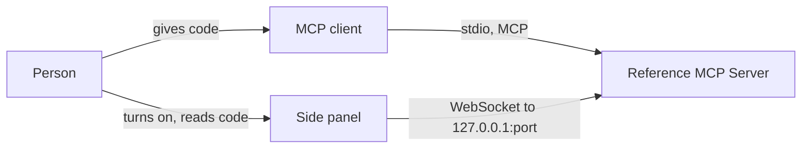

# Reference MCP Server

The Reference MCP Server is a small local process that offers the commands of
the [Local Control Channel](../../docs/api/control-channel.md) as tools of the
[Model Context Protocol](https://modelcontextprotocol.io/specification/2025-11-25)
(MCP): an MCP client starts it, calls a tool, and the server sends the
matching command to the Chrome extension's side panel and hands back the
panel's result. It is the local process of the channel specification, built on
the [Reference Control Client](../control-client/README.md), with MCP on its
other side. It exists as an easy-to-read example for anyone writing their own
local process. It is tested with the official MCP client against a stand-in
for the panel that follows the specification, and against the real panel by
the extension's end-to-end suite.

This server is part of the repository's
[reference implementations](../README.md).

> **This is a repository and testing artifact only.** The server lives under
> `reference-implementations/` (separate from `packages/`, which holds the
> shipped product) and is excluded from every release. It is never part of a
> product release and is not published to end users.

The [Local Control Channel](../../docs/api/control-channel.md) specification is
the authoritative contract for the channel, and the Model Context Protocol
specification for the tools side. This document describes how _this_ server
joins the two, and links to both rather than restating them.



---

## What it does

- **Speaks MCP over stdio, and nothing else.** The MCP client starts the
  server as a child process and exchanges one JSON-RPC message per line over
  its standard input and output. The server opens no network listener for MCP.
  It answers `initialize`, `ping`, `tools/list` and `tools/call`; it declares
  the `tools` capability alone and sends the client no request of its own.
- **Offers one tool per channel command, and `pair`.** The tool list is
  closed: the seven commands of
  [LC-7](../../docs/api/control-channel.md#the-command-set) and the pairing.
  A tool the list does not name is refused.
- **Leaves the channel to the control client.** Listening on `127.0.0.1`
  only while a pairing is awaited, accepting the configured extension alone,
  the proof in both directions, and matching results to commands are the
  [Reference Control Client](../control-client/README.md)'s, unchanged. Each
  `pair` call makes a new control client, since a client pairs once.
- **Hands results back as the panel sent them.** A command tool's result is
  the panel's result frame without its `type` and `id`: the frame's own `ok`,
  its fields, and on `ok: false` its `error`. The server reads `ok` to mark
  the tool call as failed and, on an export, the `export` object and the
  project's name; it interprets nothing else.
- **Writes an export to a file and returns where.** `project_export` writes
  the `export` object of the panel's result into the configured export
  folder, as JSON with a two-space indent, the form the panel's Export button
  downloads, and returns the file's path and its size in bytes in place of
  the document. The server reads nothing in the document.
- **Checks a tool's arguments before anything is sent.** Arguments that do
  not match the tool's input schema are answered as a failed tool call, and
  the panel receives nothing. The schema states each argument's name, type
  and allowed values; the lengths LC-7 states are the panel's to check, after
  its own trimming.

The pairing code passes through the MCP client, since a person gives it
there, and a client may send what it handles to a remote service. The code is
good for one attempt and is spent by the attempt that uses it
([LC-5](../../docs/api/control-channel.md#pairing)). The server holds it for
the `pair` call alone and writes nothing to its standard error after
start-up. Its own refusals carry no value from a call: neither the code, a
proof nor an argument. A command's result is the panel's, and carries what
the panel puts there, a name the call gave included.

---

## Using it

Node.js 24 or later. The server builds on the control client beside it, so
install both, from `reference-implementations/`:

```bash
cd control-client && npm ci
cd ../mcp-server && npm ci
```

`npm ci --omit=dev` in `mcp-server` is enough to run the server: its
development dependency, the official MCP SDK, is used by the tests alone.

An MCP client is then configured to start the server, with the options it
needs. The form of that configuration is the client's own; the command is:

```bash
node /path/to/docent/reference-implementations/mcp-server/server.js --export-dir /path/to/exports
```

Give both paths in full: the MCP client chooses the directory the server
starts in.

The flow is the channel's own. A person turns
[Local control](../../docs/user/extension.md#local-control) on in the side
panel, with the same port and, for exports, with export allowed, reads the
pairing code the panel then shows, and gives it to the MCP client, which
calls `pair` with it. From then on each tool call is one command.

An extension loaded from source has an id of its own, which Chrome shows on
its `chrome://extensions` page; give it with `--extension-id`. A connection
from any other extension id is refused, so with the wrong id a `pair` call
ends as if nothing had dialed, with `pairing-timeout`.

### Options

| Option                   | Default                                              | Meaning                                                                                         |
| ------------------------ | ---------------------------------------------------- | ----------------------------------------------------------------------------------------------- |
| `--port <n>`             | `8765`, the port the panel's turn-on control offers  | The port the person gave the panel, 1024 to 65535                                               |
| `--extension-id <id>`    | `odhpdgpoknpaakjdkdbjdgpljmpblijh`, the published id | The extension whose `Origin` is accepted; a build loaded from source states its own             |
| `--export-dir <dir>`     | None                                                 | An existing folder `project_export` writes into; without it, `project_export` is refused        |
| `--pair-timeout-ms <ms>` | `30000`                                              | How long a `pair` call waits for the panel to connect and complete the pairing, in milliseconds |
| `--help`                 |                                                      | Prints the options to standard error and exits                                                  |

An option the server does not define, a value out of range, or an export
folder that does not exist is reported on standard error, and the server
exits with status 2 before it reads a message. The panel dials the port every
2 seconds while the channel is on
([LC-3](../../docs/api/control-channel.md#address)), so a `pair` call made
after turn-on completes within a few seconds; the default wait is shorter than
the control client's so that a call with nobody at the panel returns while an
MCP client is still waiting for it. The server does not act on a client's
cancellation of a call, so a wait longer than the client's own leaves a
`pair` call listening after the client has given up on it, and a `pair` call
made meanwhile is refused as under way. A relative `--export-dir` is read
against the directory the server is started in.

### Tools

| Tool               | Arguments                                                                             | Command sent       |
| ------------------ | ------------------------------------------------------------------------------------- | ------------------ |
| `pair`             | `code`: the pairing code the panel shows                                              | None: the pairing  |
| `status`           | None                                                                                  | `status`           |
| `project_create`   | `name`                                                                                | `project.create`   |
| `recording_create` | `name`                                                                                | `recording.create` |
| `recording_pause`  | None                                                                                  | `recording.pause`  |
| `recording_resume` | None                                                                                  | `recording.resume` |
| `step_commit`      | Either `narration`, or `step_type` (`action` or `validation`), with `expect` optional | `step.commit`      |
| `project_export`   | None                                                                                  | `project.export`   |

What each command does, what it is refused for and what its result carries
are the specification's
([LC-7 to LC-9](../../docs/api/control-channel.md#the-command-set)).

### Results

Every tool call that names a tool of the list, with an object for its
arguments, is answered with a tool result; a fault inside the server itself
is the one exception, answered as an internal error. The result carries one JSON object twice: as
`structuredContent`, and serialized in one text block of `content`. `isError`
is `true` exactly when the object's `ok` is `false`.

| Outcome                                     | The object                                                             |
| ------------------------------------------- | ---------------------------------------------------------------------- |
| The panel carried the command out           | `{ "ok": true, … }` with the result fields LC-9 states for the command |
| The panel answered `ok: false`              | `{ "ok": false, "error": "<the panel's text>" }`                       |
| `pair` succeeded                            | `{ "ok": true }`                                                       |
| `project_export` succeeded                  | `{ "ok": true, "project": { … }, "path": "<file>", "bytes": <size> }`  |
| The server or the control client refused it | `{ "ok": false, "code": "<code>", "message": "<text>" }`               |

A refusal's `code` is one of the control client's
([its table](../control-client/README.md#surface)) or one of the server's
own. The message is that code's fixed text, written for a person to read;
`invalid-arguments` adds one sentence naming the argument at fault or the
arguments the tool takes, and the control
client adds its own sentence to a failure that ends a channel with commands
waiting:

| Code                 | When                                                                                          |
| -------------------- | --------------------------------------------------------------------------------------------- |
| `invalid-arguments`  | The arguments do not match the tool's input schema; nothing was sent                          |
| `already-paired`     | `pair` was called while a panel is paired                                                     |
| `pairing-under-way`  | `pair` was called while an earlier `pair` call is still waiting                               |
| `no-export-folder`   | `project_export` was called on a server started without `--export-dir`; nothing was sent      |
| `export-not-usable`  | The panel answered `ok: true` without an `export` object and a project name                   |
| `export-not-written` | The export file could not be written; the export counts in the panel's indicator all the same |
| `too-many-calls`     | 16 tool calls are already in progress; the call was not started                               |

A command sent before any `pair` call, or after one refused for the code's
shape, is answered with the control client's `not-paired`. One sent after a
pairing that failed, or after the connection ended, is answered with the
failure that ended it. After either, `pair` may be called again, with the new
code the panel shows once the channel is turned on again
([LC-10](../../docs/api/control-channel.md#turning-the-channel-off)).

A protocol error answers what is not a tool call the server can start: a
method it does not offer, a tool name outside the list, a malformed message,
a batch, or a request other than `ping` before `initialize`. The answer to a
message whose id could not be read carries no `id`.

### The export file

The file is created in the export folder and nowhere else, and the path
returned is absolute. Its name is `<name>_<time>.docent.json`: the first 100
characters of the project's name, with every character other than an ASCII
letter, a digit, `_` and `-` replaced by `_`, and `project` for an empty
name; then the time of the export in milliseconds. The server creates the
file itself and never writes over an existing one or through a link: a name
already taken gets `_2`, `_3` and so on after the time. A file whose writing
fails part-way is removed. On Linux and macOS the file is readable and
writable by its owner alone; on Windows it takes the folder's permissions.
The export folder is the one place on disk the server writes to.

An export arrives as one frame, and the control client reads frames of up to
64 MiB. A larger one ends the channel with `frame-too-large-received`.

### Protocol revisions

The server speaks the MCP revisions `2025-11-25` and `2025-06-18`. It answers
`initialize` with the revision the client asked for when it is one of the
two, and with `2025-11-25` otherwise, as the MCP lifecycle states. It does not
accept JSON-RPC batches, which those two revisions do not use. Under both it
answers arguments outside a tool's schema as a failed tool call, the reading
the `2025-11-25` revision states.

---

## Running the tests

From `reference-implementations/mcp-server/`, after the two installs above:

```bash
npm test                 # both layers
npm run test:unit        # the pure parts: messages, options, schemas, the export file
npm run test:integration # the server as a child process, driven by the official MCP client
```

The integration layer starts `server.js` as a child process and drives it
with the client of the official
[MCP SDK](https://github.com/modelcontextprotocol/typescript-sdk), a
development dependency of this package alone, so the hand-written MCP layer
is checked against the protocol's own implementation. The panel's side is the
control client's stand-in, which follows the panel's side of the
specification. Neither layer runs the real panel. CI runs both layers in the
`mcp-server-tests` job
([CI gates](../../docs/guides/ci.md#path-filtered-test-jobs)).

The real panel is run against this server by the extension's end-to-end
suite: its `control-channel-mcp-server.spec.js` starts `server.js` beside a
real browser with the extension loaded and pairs, records, exports and
imports through it
([End-to-end tests](../../docs/test/e2e.md#what-the-suite-covers)).

---

## Layout

| File                 | Role                                                              |
| -------------------- | ----------------------------------------------------------------- |
| `server.js`          | The entry point: reads the options and joins the parts over stdio |
| `options.js`         | Reading the command line                                          |
| `stdio.js`           | One JSON-RPC message per line, in and out                         |
| `jsonrpc.js`         | Reading a message and writing a response                          |
| `mcp.js`             | The MCP methods: `initialize`, `ping`, `tools/list`, `tools/call` |
| `tools.js`           | The tool list, each tool's input schema, and the check against it |
| `session.js`         | The pairing and the commands, over the control client             |
| `failures.js`        | The server's own refusals and their fixed texts                   |
| `export-file.js`     | Naming and writing the export file                                |
| `tests/unit/`        | The pure parts                                                    |
| `tests/integration/` | The server as a child process, with the official MCP client       |
